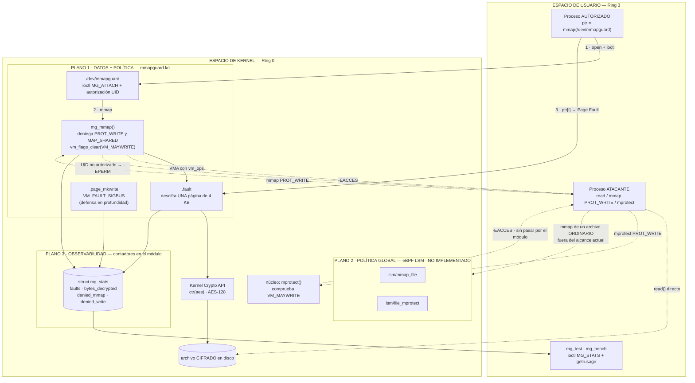

# 3.3 Estrategia Arquitectónica Seleccionada

> Parcial 25% — Seguridad de Archivos mediante Intervención en la Capa del Kernel y Mapeo de Memoria (mmap)
> Kernel objetivo: `6.18.33.2-microsoft-standard-WSL2` (x86_64)

---

## 1. Modelo de amenaza

Toda decisión posterior se justifica contra este modelo. Declararlo explícitamente delimita qué
significa que la defensa "funcione".

**Atacante asumido.** Proceso local sin privilegios: sin `root`, sin `CAP_SYS_ADMIN`, sin
`CAP_SYS_MODULE` y sin capacidad de cargar o descargar módulos. Puede ejecutar código arbitrario
en Ring 3, abrir descriptores, invocar `mmap()`, `mprotect()`, `madvise()` y `msync()`, y lanzar
procesos e hilos concurrentes.

**Activo protegido.** Un archivo confidencial cifrado en reposo, que un proceso autorizado necesita
leer mediante acceso por puntero (sin pagar el costo de `read()`).

**Objetivos de seguridad**, tomados literalmente del enunciado:

| Objetivo | Significado operativo |
| :--- | :--- |
| Aislamiento de memoria | El texto en claro nunca reside completo en RAM, y nunca es legible por un proceso no autorizado |
| Prevención de modificaciones no autorizadas | Un mapeo escribible sobre el activo es denegado antes de que exista la PTE |
| Auditoría de accesos | Todo intento, exitoso o denegado, produce un evento verificable |

**Fuera de alcance.** Atacante con `root` (puede `rmmod` el módulo y desadjuntar los programas
eBPF); ataques físicos o por DMA; canales laterales de microarquitectura (Spectre/Meltdown);
compromiso del hipervisor. Estos vectores se retoman en la sección de limitaciones y trabajo futuro.

---

## 2. Alternativas evaluadas y criterio de descarte

Las afirmaciones de esta sección **no son de memoria**: se verificaron por inspección directa del
árbol `linux-msft-wsl-6.18.33.2`, que es exactamente el del kernel en ejecución. Se cita archivo y
línea.

### 2.1 LKM con hook en la System Call Table — DESCARTADA

Es la técnica que la Pregunta 4 del parcial pone en contraste con LSM. Se descarta por cuatro
razones independientes, cada una suficiente:

1. **La tabla no es alcanzable por vía legítima.** `sys_call_table` no está exportada, y
   `kallsyms_lookup_name()` tampoco lo está desde 5.7, de modo que obtener su dirección exige
   instalar un `kprobe` sobre la propia `kallsyms_lookup_name` — un rodeo cuyo único propósito es
   evadir una decisión deliberada de los mantenedores.
2. **Exige desarmar una protección del procesador.** Escribir la tabla obliga a limpiar el bit WP
   de `CR0`. Esto es, textualmente, el ejemplo de práctica insegura que el propio enunciado cita en
   la sección 3.2.
3. **Es intrínsecamente propensa a carreras.** Durante la reescritura de la entrada, otra CPU puede
   estar ejecutando esa misma syscall. No existe forma de serializar ese acceso desde un módulo.
4. **Incompatibilidad estructural.** En x86_64 las syscalls se despachan por envoltorios
   `__x64_sys_*(struct pt_regs *)`, y la técnica entra en conflicto con CFI y con `lockdown`.

Se documenta como alternativa evaluada, no como implementación.

### 2.2 LSM propio registrado desde un módulo cargable — INVIABLE

`security_add_hooks()` no está exportada y la inicialización del framework LSM es `__init`, con la
tabla de módulos fijada en tiempo de compilación. **No existe forma soportada de registrar un LSM
desde un módulo cargable.** La ruta exigiría recompilar e instalar un kernel completo por cada
iteración de desarrollo, lo que es incompatible con el plazo.

### 2.3 eBPF solo con `fentry`/`kprobes` — INSUFICIENTE

`fentry` y `kprobes` observan pero **no pueden denegar**: su valor de retorno no altera el flujo de
la función instrumentada. Sirven para auditoría, no para prevención, y el enunciado exige
prevención. Se conserva como plano de observabilidad, no como mecanismo de control.

### 2.4 Tabla de verificación

| Afirmación | Verificado en | Resultado |
| :--- | :--- | :---: |
| `kallsyms_lookup_name` no exportada | `kernel/kallsyms.c` | Confirmado |
| `sys_call_table` no exportada | `arch/x86/` | Confirmado |
| `security_add_hooks` no exportada | `security/` | Confirmado |
| `vm_flags_set()` obligatorio para mutar banderas | `include/linux/mm.h:808` | Confirmado |
| `.page_mkwrite` disponible en `vm_operations_struct` | `include/linux/mm.h:638` | Confirmado |
| Hook LSM `mmap_file` | `include/linux/lsm_hook_defs.h:199` | Confirmado |
| Hook LSM `file_mprotect` | `include/linux/lsm_hook_defs.h:201` | Confirmado |

---

## 3. Arquitectura seleccionada: defensa en profundidad en tres planos

Ningún mecanismo único cubre los tres objetivos de seguridad. La arquitectura asigna **un plano por
objetivo**, de modo que la correspondencia con el enunciado es uno a uno:

| Objetivo del enunciado | Plano | Mecanismo | Artefacto | Estado |
| :--- | :--- | :--- | :--- | :--- |
| Aislamiento de memoria | **Datos** | LKM con `vm_ops->fault` y descifrado por página | `mmapguard.ko` | **Implementado** |
| Prevención de modificaciones | **Política** | Rechazo en `mg_mmap()` + `vm_flags_clear(VM_MAYWRITE)` | `mmapguard.ko` | **Implementado** |
| | | eBPF LSM sobre `mmap_file` y `file_mprotect` (cobertura global) | `mg_lsm.bpf.c` | No implementado |
| Auditoría de accesos | **Observabilidad** | Contadores `struct mg_stats` vía `ioctl` + `getrusage` | `mmapguard.ko` + `mg_bench` | **Implementado** |
| | | eBPF con tracepoints y ring buffer | `mg_audit.bpf.c` | No implementado |

El plano 2 se desdobla porque la prevención **sí se logró**, pero dentro del plano 1 y con alcance
limitado a lo que pasa por `/dev/mmapguard`. La variante eBPF LSM, que extendería esa misma
prevención a cualquier archivo del sistema, quedó condicionada a un requisito de arranque que este
entorno no satisface (sección 3.3). La distinción importa: lo que falta no es el control, es su
alcance.

### 3.1 Diagrama conceptual

### 3.2 Plano 1 — Datos: `mmapguard.ko`

Dispositivo de caracteres `/dev/mmapguard`. El flujo es: `open()`, luego
`ioctl(MG_IOC_ATTACH, struct mg_attach_req {path, flags})`, que compara el UID efectivo del
llamante con el parámetro `authorized_uid` del módulo y prepara el respaldo del archivo cifrado; y
finalmente `mmap()` sobre el descriptor. La clave no viaja en el `ioctl`: es un parámetro del
módulo (`key_hex`), de modo que el espacio de usuario nunca la manipula.

**Decisión técnica central: `vm_ops->fault` en lugar de `remap_pfn_range()`.**

El paso 4 del repositorio de referencia usa `remap_pfn_range()`, que programa de golpe todas las
PTE del rango. Aplicado a un archivo confidencial, eso obliga a mantener **el archivo completo
descifrado en RAM** durante toda la vida del mapeo. El paso 6 usa `vm_operations_struct->fault`,
que entrega las páginas de a una, bajo demanda real.

La consecuencia es de seguridad, no de rendimiento: con el fault handler se descifra **una página
de 4 KB a la vez, y solo cuando el proceso efectivamente la toca**. La ventana de exposición en
memoria física se reduce de "todo el archivo" a "las páginas realmente usadas". Esto reconvierte la
paginación por demanda, que en el repositorio de referencia es una optimización, en un **control de
minimización de exposición**.

**Segunda decisión: el mapeo es estrictamente de solo lectura.**

El cifrado es AES en modo CTR con el bloque contador derivado del índice de página, que es lo que
permite descifrar cada página de forma independiente. Pero CTR es un cifrado de flujo: reutilizar
clave y nonce sobre dos textos planos distintos revela su XOR. Permitir escritura obligaría a
re-cifrar cada página sucia con el mismo nonce en cada `msync()`, incurriendo de forma sistemática
en esa falla.

Por eso el mapeo se concede solo con `PROT_READ`, y la prevención de escritura se implementa en dos
capas:

1. **`vm_flags_clear(vma, VM_MAYWRITE)` en el alta del mapeo.** Retirar esa bandera hace que sea
   **el propio kernel** quien rechace tanto `PROT_WRITE` en `mmap()` como una escalada posterior
   con `mprotect()`. No se intercepta `mprotect` en ninguna parte: se utiliza la misma maquinaria
   descrita en la Pregunta 2 para que la escalada sea imposible por construcción.
2. **`.page_mkwrite` como defensa en profundidad.** Es el único callback donde el kernel recupera
   el control ante la primera escritura sobre una página limpia ya mapeada — el "punto crítico de
   vulnerabilidad" del infograma del enunciado. Con la capa anterior en su sitio no debería
   ejecutarse nunca; si lo hace, significa que algo burló la primera barrera, y entonces deniega
   con `VM_FAULT_SIGBUS` y audita el intento.

El soporte de lectura-escritura con detección de integridad exige un modo AEAD
(ChaCha20-Poly1305 o AES-GCM) con contador de versión por página y un área de metadatos para los
tags. Está especificado como trabajo futuro: se prefirió un cifrado de solo lectura correcto frente
a uno de lectura-escritura con una debilidad criptográfica conocida.

Notas de implementación relevantes para kernel 6.x:

- Las banderas del VMA se mutan con `vm_flags_set()` y `vm_flags_clear()`, nunca por asignación
  directa: `vm_flags` está declarado `const` dentro de una unión y los setters toman el bloqueo de
  escritura del VMA (ver Preguntas 4 y 9). `VM_DONTEXPAND` impide que el VMA crezca y
  `VM_DONTDUMP` evita que el texto en claro llegue a un core dump.
- La criptografía usa la Kernel Crypto API (`ctr(aes)`), con el bloque contador construido como
  `índice_de_página × (PAGE_SIZE / 16)` en big-endian, de modo que cada página consume una región
  distinta del flujo de clave.
- `no_llseek` fue eliminado en 6.12 y `put_unaligned_be64()` se trasladó de `<asm/unaligned.h>` a
  `<linux/unaligned.h>`. Ambos se detectaron por inspección del árbol antes de compilar.

**Resultado medido.** Sobre un archivo de 4.764 bytes (2 páginas), un cliente que lee solo los
primeros 64 bytes produce: 1 página descifrada, 4.096 bytes en claro en RAM, y la segunda página
nunca materializada. Con `remap_pfn_range()` ambas páginas estarían descifradas desde el instante
del `mmap()`. Es la confirmación empírica de la decisión central de este plano.

### 3.3 Plano 2 — Política: `mg_lsm.bpf.c`

Programas eBPF adjuntos a `SEC("lsm/mmap_file")` y `SEC("lsm/file_mprotect")`, que retornan
`-EPERM` para denegar.

- `mmap_file` deniega `PROT_WRITE | MAP_SHARED` sobre inodos marcados como protegidos, y deniega
  cualquier mapeo desde UIDs no autorizados. La decisión se toma **antes de que exista el VMA**.
- `file_mprotect` cierra la evasión clásica: mapear de forma benigna con `PROT_READ` y escalar
  después con `mprotect(PROT_WRITE)`. Sin este segundo gancho, el primero es trivialmente
  rodeable.

La política vive en un `BPF_MAP_TYPE_HASH` indexado por `(dev, inode)`, poblado desde espacio de
usuario, de modo que se puede cambiar sin recargar nada.

Ventaja decisiva sobre el plano 1: protege **archivos reales del sistema de archivos**, no solo lo
que pase por nuestro dispositivo. Es lo que convierte la solución en un mecanismo de seguridad y no
en una demostración acotada.

**Requisito de arranque.** `CONFIG_BPF_LSM=y` está activo en este kernel, pero `CONFIG_LSM` no
incluye `bpf` en su lista y el `/proc/cmdline` no trae parámetro `lsm=`. Hay que añadir `bpf` a la
lista de LSM activos vía `kernelCommandLine` en `.wslconfig`. Sin eso los ganchos existen pero no
son adjuntables.

### 3.4 Plano 3 — Observabilidad: contadores en el módulo

**Lo implementado.** La auditoría reside en el propio `mmapguard.ko`, en una `struct mg_stats` que
el módulo mantiene por sesión y que el espacio de usuario recupera con `ioctl(MG_IOC_STATS)`:

| Campo | Qué registra |
| :--- | :--- |
| `faults` | páginas efectivamente materializadas por `.fault` |
| `bytes_decrypted` | volumen descifrado, es decir la exposición real en RAM |
| `denied_mmap` | mapeos rechazados por `mg_mmap()` |
| `denied_write` | escrituras atajadas por `.page_mkwrite` |

A esto se suman los contadores que el propio kernel ya lleva por proceso, leídos con `getrusage()`
en `mg_bench`: `ru_minflt`, `ru_majflt`, `ru_utime` y `ru_stime`. Esa es la fuente de las métricas
de la sección 4.2, y la línea base de comparación es `mmap()` ordinario sobre el archivo en claro.

**Un hallazgo que condicionó el diseño de este plano.** La instrumentación *tenía* que vivir dentro
del kernel: `strace` no observa nada del trabajo de `mmapguard` porque **un fallo de página no es
una llamada al sistema**. Una traza del cliente muestra 30 llamadas a `mmap` y ninguna señal de las
4.097 páginas descifradas. Un enfoque de auditoría basado en interceptar syscalls desde usuario
sería ciego precisamente donde ocurre todo.

**La variante descartada por ahora.** El diseño original contemplaba tracepoints sobre `msync` y
`madvise` más un `kprobe` en `handle_mm_fault`, emitiendo por un ring buffer BPF hacia un demonio en
espacio de usuario. Aporta dos cosas que los contadores no dan: observación de procesos que no usan
nuestro dispositivo, y granularidad por evento en vez de agregados. Queda como trabajo futuro, con
la misma condición de arranque del plano 2.

---

## 4. Matriz de compensaciones (rendimiento vs. seguridad)

| Alternativa | Cobertura | Profundidad de inspección | Sobrecosto | Riesgo de kernel panic | Viable en este entorno |
| :--- | :--- | :--- | :--- | :---: | :---: |
| Hook de syscall table | Global | Solo argumentos de la syscall | Bajo | **Alto** | Sí, pero insegura |
| **LKM con `vm_ops->fault`** | Solo su dispositivo | **Máxima: página a página** | **Alto**: un fallo por página | Medio | **Sí** |
| LSM compilado en el kernel | Global | Alta | Bajo | Bajo | No: exige recompilar |
| **eBPF LSM** | **Global** | Media: decisión al crear el VMA | **Muy bajo**: una vez por `mmap` | **Nulo**: verificador | Sí, con `lsm=...,bpf` |
| eBPF `fentry`/`kprobe` | Global | Solo observación | Muy bajo | Nulo | Sí |

**El eje del compromiso: la profundidad de inspección se paga en fallos de página.**

El plano 1 ve el contenido de cada página, pero cuesta un `#PF` y una operación criptográfica por
página tocada — un sobrecosto que crece linealmente con el volumen de datos realmente accedido. El
plano 2 decide **una sola vez**, en el alta del VMA, y a partir de ahí su costo marginal es cero,
pero nunca ve el contenido.

Son complementarios, no sustitutos, y esa es la razón de combinarlos en lugar de elegir uno: el
plano 2 aporta cobertura global a costo despreciable y el plano 1 aporta profundidad donde de
verdad hace falta. La hipótesis cuantitativa a validar en la Parte III es que **el sobrecosto del
plano 2 sea indistinguible del ruido**, mientras que el del plano 1 escale con las páginas
efectivamente tocadas y no con el tamaño del archivo.

---

## 5. Alcance por fases

| Fase | Contenido | Estado |
| :--- | :--- | :--- |
| 0 | Entorno: árbol de kernel con `Module.symvers`, toolchain eBPF | En curso |
| 1 | Plano 1 — `mmapguard.ko` | Comprometida |
| 2 | Plano 3 — auditoría y mediciones de la sección 4.2 | Comprometida |
| 3 | Plano 2 — eBPF LSM | Condicional al tiempo restante |

La fase 1 es autosuficiente: entrega código C funcional que compila en kernel moderno, asegura
`mmap()` mediante cifrado y autorización, y admite medición de sobrecosto. Si el plazo obliga a
detenerse ahí, el plano 2 se documenta como trabajo futuro con su diseño ya especificado, que es
una salida contemplada por la rúbrica.

---

## 6. Banco de pruebas: ataques a demostrar

El enunciado exige scripts que simulen accesos no autorizados, carreras y modificaciones indebidas.
Cada PoC se corresponde con una pregunta de la Parte I, lo que mantiene el informe cohesionado. El
banco vive en `tests/run_pocs.sh` (orquestación, verificación del entorno y resumen) y
`tests/mg_poc.py` (los ataques, por `ctypes` contra libc, para controlar las banderas exactas de
`mmap`/`mprotect`/`madvise` y leer el `errno` exacto de cada rechazo); `tools/mg_test` queda como
cliente de referencia en C.

| PoC | Ataque | Resultado obtenido | Pregunta | Estado |
| :--- | :--- | :--- | :---: | :--- |
| A0 | Asociación desde un UID no autorizado | `-EPERM` desde `mg_do_attach()`, `denied_mmap = 1` | 4 | **Verificado** |
| A1 | Lectura directa del archivo con `read()` | Devuelve texto cifrado | 5 | **Verificado** |
| A2 | `mmap` con `PROT_WRITE` o `MAP_SHARED` | `-EACCES` desde `mg_mmap()`, salvo `MAP_SHARED` sobre un `fd` de solo lectura, que el núcleo degrada antes | 2 | **Verificado** |
| A3 | `mmap` con `PROT_READ` y luego `mprotect(PROT_WRITE)` | `-EACCES`, emitido por el núcleo | 3 | **Verificado** |
| A4 | `fd` en `O_RDONLY` mapeado `PROT_WRITE \| MAP_PRIVATE` | Sobre un archivo **ordinario** el núcleo lo concede: `NOMINA C` → `AAAAAAAA` en memoria, `sha256` del disco intacto; sobre `/dev/mmapguard`, `EACCES` | 8 | **Verificado** |
| A5 | Carrera entre `madvise(MADV_DONTNEED)` y escritura | `SIGSEGV` en la escritura; 21.615 descartes y 0 discrepancias en 11.229 relecturas | 9 | **Verificado** |
| A6 | `msync` tras manipular páginas mapeadas | No aplicable al mapeo de solo lectura; requiere modo AEAD: trabajo futuro | 6 | No aplicable |

El contraste entre A2 y A3 es el resultado más informativo del conjunto: `denied_mmap` marcó 1 y no
2, porque el `mprotect` **nunca llegó al módulo**. Lo rechazó el propio núcleo al comprobar
`VM_MAYWRITE`, que es exactamente el efecto buscado al limpiar ese bit en vez de interceptar la
llamada.

Dos notas de diseño del banco, porque A4 y A5 no son repeticiones del patrón «se intenta, se
deniega»:

**A4 demuestra primero que la evasión existe.** Mostrar que `/dev/mmapguard` rechaza el mapeo no
prueba nada por sí solo: habría que saber que el ataque funciona en otro sitio. Así que la PoC abre
`demo/secreto.txt` en `O_RDONLY`, comprueba que el núcleo **concede** `PROT_WRITE | MAP_PRIVATE`,
altera los ocho primeros bytes en memoria y verifica por `sha256` que el archivo en disco quedó
intacto. Eso reproduce exactamente el escenario de la pregunta 8 — `O_RDONLY` no impide ver el
contenido en claro ni alterarlo en la copia privada — y solo entonces repite el ataque contra el
dispositivo protegido.

**A5 mide en vez de argumentar, y por eso corrige una afirmación previa.** La fase 1 lanza un
proceso hijo aislado que intenta escribir en el mapeo y comprueba que muere con `SIGSEGV`: la señal
no se puede capturar, de modo que la muerte del hijo *es* el resultado positivo. La fase 2 martillea
`MADV_DONTNEED` desde cuatro hilos mientras el hilo principal reverifica el digest del mapeo
completo, y mide `ru_minflt` con `getrusage()` para probar que las PTE se estaban descartando de
verdad; sin ese dato, un martilleo que no descarta nada «pasaría» la prueba sin haber probado nada.

Esa medición desmiente una afirmación que este documento sostenía antes: que tras el descarte «el
siguiente acceso vuelve a fallar y se redescifra». Lo primero es cierto, lo segundo no. El fallo
nuevo encuentra la página en `s->pages[pgoff]` y devuelve la misma página en claro tomando una
referencia (`src/mmapguard.c:252-259`), sin volver a descifrar y sin incrementar `faults`, que solo
crece en la materialización inicial (`src/mmapguard.c:297`). La consecuencia importa para el modelo
de amenaza: **la ventana de exposición del texto en claro es la vida de la sesión, no la vida de la
PTE**. `MADV_DONTNEED` retira la traducción del proceso, no la copia descifrada del módulo, que
solo se borra en `mg_release()` con `memzero_explicit()`. Reducir esa ventana —descartar páginas en
claro por presión o por temporizador— es trabajo futuro, y es el mismo eje que la respuesta 9
señala al advertir que un veredicto cacheado es un objetivo de carrera.

---

## 7. Trazabilidad con la Parte I

La arquitectura no es independiente de las preguntas conceptuales: las respuestas 4 y 7 justifican
directamente el descarte de la sección 2 y la elección del plano 2, mientras que las respuestas 1,
3, 8, 9 y 10 fundamentan el diseño del plano 1. Las respuestas de la Parte I deben citar esta
sección y viceversa.
