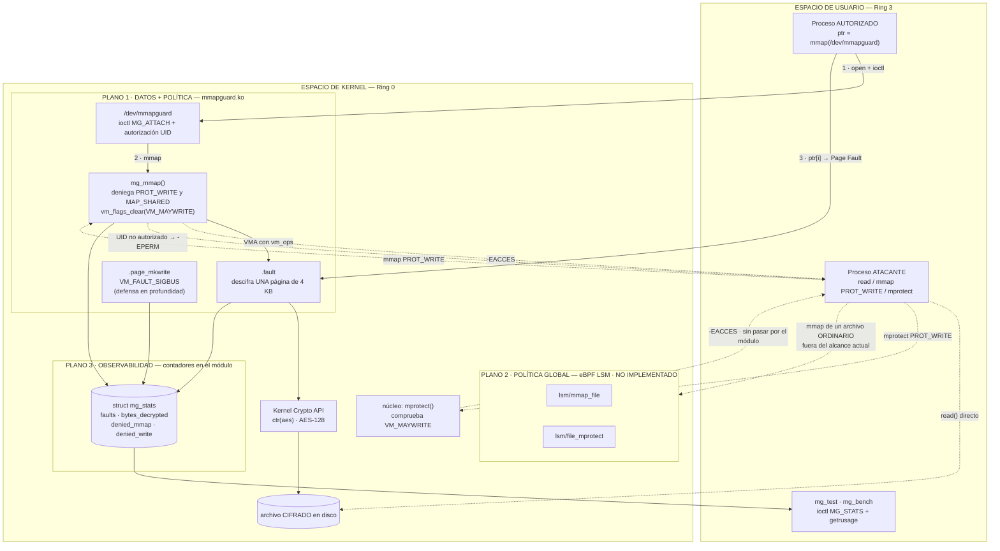

# 3.3 Estrategia Arquitectónica Seleccionada

> Kernel objetivo: `6.18.33.2-microsoft-standard-WSL2` (x86_64)

## 1. Modelo de amenaza

**Atacante asumido.** Proceso local sin privilegios —sin `root`, sin `CAP_SYS_ADMIN`, sin
`CAP_SYS_MODULE`— que puede ejecutar código arbitrario en Ring 3, abrir descriptores, invocar
`mmap()`, `mprotect()`, `madvise()` y `msync()`, y lanzar procesos e hilos concurrentes. **Activo
protegido:** un archivo confidencial cifrado en reposo que un proceso autorizado necesita leer por
acceso por puntero, sin pagar el costo de `read()`.

| Objetivo del enunciado | Significado operativo |
| :--- | :--- |
| Aislamiento de memoria | El texto en claro nunca reside completo en RAM ni es legible por un proceso no autorizado |
| Prevención de modificaciones | Un mapeo escribible sobre el activo se deniega antes de que exista la PTE |
| Auditoría de accesos | Todo intento, exitoso o denegado, produce un evento verificable |

**Fuera de alcance.** Atacante con `root` (puede `rmmod` el módulo); ataques físicos o por DMA;
canales laterales de microarquitectura; compromiso del hipervisor.

## 2. Alternativas evaluadas y criterio de descarte

Las afirmaciones de esta sección **no son de memoria**: cada una se verificó por inspección del árbol
`linux-msft-wsl-6.18.33.2`, que es el del kernel en ejecución, y las citas con archivo y línea están
en la tabla de verificaciones de la sección 3.2 (V2–V5, V7).

**2.1 LKM con hook en la System Call Table — DESCARTADA.** Cuatro razones independientes, cada una
suficiente: la tabla no es alcanzable por vía legítima (`sys_call_table` no exportada, y
`kallsyms_lookup_name()` tampoco desde 5.7, de modo que obtener la dirección exige un `kprobe` sobre
la propia función, un rodeo cuyo único propósito es evadir una decisión deliberada de los
mantenedores); exige **limpiar el bit WP de `CR0`**, textualmente el ejemplo de práctica insegura que
cita el enunciado; es propensa a carreras, porque durante la reescritura otra CPU puede estar
ejecutando esa misma syscall; y en x86_64 choca con el despacho por envoltorios
`__x64_sys_*(struct pt_regs *)`, con CFI y con `lockdown`.

**2.2 LSM propio desde un módulo cargable — INVIABLE.** `security_add_hooks()` no está exportada y la
inicialización del framework es `__init`, con la tabla fijada en compilación. No existe forma
soportada; la ruta exigiría recompilar e instalar un kernel por cada iteración de desarrollo.

**2.3 eBPF solo con `fentry`/`kprobes` — INSUFICIENTE.** Observan pero **no pueden denegar**: su
valor de retorno no altera el flujo. Sirven para auditoría, no para prevención, y el enunciado exige
prevención. Se conserva como plano de observabilidad, no como mecanismo de control.

## 3. Arquitectura seleccionada: tres planos

Ningún mecanismo único cubre los tres objetivos. La arquitectura asigna **un plano por objetivo**:

| Objetivo | Plano | Mecanismo | Artefacto | Estado |
| :--- | :--- | :--- | :--- | :--- |
| Aislamiento | **Datos** | LKM con `vm_ops->fault` y descifrado por página | `mmapguard.ko` | **Implementado** |
| Prevención | **Política** | Rechazo en `mg_mmap()` + `vm_flags_clear(VM_MAYWRITE)` | `mmapguard.ko` | **Implementado** |
| | | eBPF LSM sobre `mmap_file` y `file_mprotect` (cobertura global) | `mg_lsm.bpf.c` | No implementado |
| Auditoría | **Observabilidad** | `struct mg_stats` vía `ioctl` + `getrusage` | `mmapguard.ko`, `mg_bench` | **Implementado** |

El plano 2 se desdobla porque la prevención **sí se logró**, pero dentro del plano 1 y con alcance
limitado a lo que pasa por `/dev/mmapguard`. La variante eBPF LSM, que la extendería a cualquier
archivo del sistema, quedó condicionada a un requisito de arranque que este entorno no satisface.
**Lo que falta no es el control, es su alcance.**

### 3.1 Diagrama

### 3.2 Plano 1 — Datos: `mmapguard.ko`

Dispositivo de caracteres `/dev/mmapguard`. El flujo es `open()`, luego
`ioctl(MG_IOC_ATTACH, struct mg_attach_req {path, flags})`, que compara el UID efectivo del llamante
con el parámetro `authorized_uid` del módulo y prepara el respaldo del archivo cifrado, y finalmente
`mmap()` sobre el descriptor. La clave no viaja en el `ioctl`: es un parámetro del módulo
(`key_hex`), de modo que el espacio de usuario nunca la manipula.

**Decisión central: `vm_ops->fault` en lugar de `remap_pfn_range()`.** El paso 4 del repositorio de
referencia usa `remap_pfn_range()`, que programa de golpe todas las PTE del rango y obliga a mantener
**el archivo completo descifrado en RAM** durante toda la vida del mapeo. Con el fault handler se
descifra **una página de 4 KB a la vez, y solo cuando el proceso la toca**: la ventana de exposición
en memoria física baja de «todo el archivo» a «las páginas realmente usadas». Eso reconvierte la
paginación por demanda, que en el material de referencia es una optimización, en un **control de
minimización de exposición**. *Medido:* un cliente que lee los primeros 64 bytes de un archivo de 2
páginas deja 1 página descifrada y 4.096 bytes en claro en RAM, no 8.192.

**Segunda decisión: el mapeo es estrictamente de solo lectura.** El cifrado es AES-CTR con el bloque
contador derivado del índice de página, que es lo que permite descifrar cada página de forma
independiente. Pero CTR es un cifrado de flujo: reutilizar clave y nonce sobre dos textos planos
distintos revela su XOR. Permitir escritura obligaría a re-cifrar cada página sucia con el mismo
nonce en cada `msync()`, incurriendo sistemáticamente en esa falla. La prevención de escritura se
implementa entonces en dos capas:

1. **`vm_flags_clear(vma, VM_MAYWRITE)` en el alta del mapeo.** Retirar esa bandera hace que sea **el
   propio kernel** quien rechace tanto `PROT_WRITE` en `mmap()` como una escalada posterior con
   `mprotect()`. No se intercepta `mprotect` en ninguna parte: se usa la misma maquinaria descrita en
   la pregunta 2 para que la escalada sea imposible por construcción.
2. **`.page_mkwrite` como defensa en profundidad.** Es el único callback donde el kernel recupera el
   control ante la primera escritura sobre una página limpia ya mapeada —el «punto crítico de
   vulnerabilidad» del enunciado—. Con la capa anterior en su sitio no debería ejecutarse nunca; si
   lo hace, significa que algo burló la primera barrera, y deniega con `VM_FAULT_SIGBUS`.

El soporte de lectura-escritura con detección de integridad exige un modo AEAD (ChaCha20-Poly1305 o
AES-GCM) con contador de versión por página y un área de metadatos para los tags: queda como trabajo
futuro. Se prefirió un cifrado de solo lectura correcto frente a uno de lectura-escritura con una
debilidad criptográfica conocida.

### 3.3 Plano 2 — Política: `mg_lsm.bpf.c` (no implementado)

Programas eBPF adjuntos a `SEC("lsm/mmap_file")` y `SEC("lsm/file_mprotect")`, que retornan `-EPERM`
para denegar. `mmap_file` denegaría `PROT_WRITE | MAP_SHARED` sobre inodos protegidos y cualquier
mapeo desde UIDs no autorizados, **antes de que exista el VMA**; `file_mprotect` cierra la evasión
clásica de mapear benignamente y escalar después, sin la cual el primer gancho es trivialmente
rodeable. La política viviría en un `BPF_MAP_TYPE_HASH` indexado por `(dev, inode)`, de modo que se
cambia sin recargar nada. Su ventaja decisiva sobre el plano 1 es que protege **archivos reales del
sistema de archivos**, no solo lo que pase por nuestro dispositivo.

**Requisito de arranque.** `CONFIG_BPF_LSM=y` está activo, pero `CONFIG_LSM` no incluye `bpf` y
`/proc/cmdline` no trae parámetro `lsm=`. Hay que añadir `bpf` a la lista vía `kernelCommandLine` en
`.wslconfig`. Sin eso los ganchos existen pero **no son adjuntables**.

### 3.4 Plano 3 — Observabilidad

La auditoría reside en el propio módulo, en una `struct mg_stats` **por sesión** que el usuario
recupera con `ioctl(MG_IOC_STATS)`: `faults` (páginas materializadas por `.fault`),
`bytes_decrypted` (la exposición real en RAM), `denied_mmap` y `denied_write`. A eso se suman los
contadores que el kernel ya lleva por proceso, leídos con `getrusage()` en `mg_bench`.

**Un hallazgo que condicionó el diseño de este plano:** la instrumentación *tenía* que vivir dentro
del kernel, porque **un fallo de página no es una llamada al sistema** (§4.4 de la sección 4.2).

## 4. Matriz de compensaciones

| Alternativa | Cobertura | Profundidad de inspección | Sobrecosto | Riesgo de panic | Viable aquí |
| :--- | :--- | :--- | :--- | :---: | :---: |
| Hook de syscall table | Global | Solo argumentos de la syscall | Bajo | **Alto** | Sí, pero insegura |
| **LKM con `vm_ops->fault`** | Solo su dispositivo | **Máxima: página a página** | **Alto**: un fallo por página | Medio | **Sí** |
| LSM compilado en el kernel | Global | Alta | Bajo | Bajo | No: exige recompilar |
| **eBPF LSM** | **Global** | Media: decide al crear el VMA | **Muy bajo**: una vez por `mmap` | **Nulo** | Sí, con `lsm=…,bpf` |
| eBPF `fentry`/`kprobe` | Global | Solo observación | Muy bajo | Nulo | Sí |

**El eje del compromiso: la profundidad de inspección se paga en fallos de página.** El plano 1 ve el
contenido de cada página, pero cuesta un `#PF` y una operación criptográfica por página tocada. El
plano 2 decide **una sola vez**, en el alta del VMA, con costo marginal cero, pero nunca ve el
contenido. Son complementarios, no sustitutos, y de ahí la decisión de combinarlos. La hipótesis
cuantitativa que valida la Parte III es que el sobrecosto del plano 1 escale con las páginas
efectivamente tocadas y no con el tamaño del archivo.

## 5. Banco de pruebas: ataques a demostrar

El banco vive en `tests/run_pocs.sh` (orquestación, verificación del entorno y resumen) y
`tests/mg_poc.py` (los ataques, por `ctypes` contra libc, para controlar las banderas exactas de
`mmap`/`mprotect`/`madvise` y leer el `errno` exacto de cada rechazo); `tools/mg_test` queda como
cliente de referencia en C. Cada PoC se corresponde con una pregunta de la Parte I.

Los siete ataques, sus resultados medidos y el análisis de los contadores están en la sección 4.2;
aquí solo las dos decisiones de diseño del banco que no son del patrón «se intenta, se deniega».

**A4 demuestra primero que la evasión existe.** Mostrar que `/dev/mmapguard` rechaza el mapeo no
prueba nada por sí solo: hay que saber que el ataque funciona en otro sitio. La PoC abre
`demo/secreto.txt` en `O_RDONLY`, comprueba que el núcleo **concede** `PROT_WRITE | MAP_PRIVATE`,
altera los ocho primeros bytes en memoria y verifica por `sha256` que el archivo en disco quedó
intacto —el escenario exacto de la pregunta 8— y solo entonces repite el ataque contra el dispositivo.

**A5 mide en vez de argumentar.** La fase 1 lanza un hijo aislado que intenta escribir y comprueba
que muere con `SIGSEGV`: la señal no se puede capturar, de modo que la muerte del hijo *es* el
resultado positivo. La fase 2 martillea `MADV_DONTNEED` desde cuatro hilos mientras el principal
reverifica el digest completo, y mide `ru_minflt` con `getrusage()` para probar que las PTE se
descartaban de verdad; sin ese dato, un martilleo que no descarta nada «pasaría» la prueba sin haber
probado nada. Esa medición obligó a corregir este documento, que antes afirmaba que tras el descarte
la página «vuelve a fallar y se redescifra»: lo segundo es falso, y la consecuencia para el modelo de
amenaza está en el §2.4 de la sección 4.2.

**Trazabilidad con la Parte I.** Las respuestas 4 y 7 justifican el descarte de la sección 2 y la
elección del plano 2; las respuestas 1, 3, 8, 9 y 10 fundamentan el diseño del plano 1.
