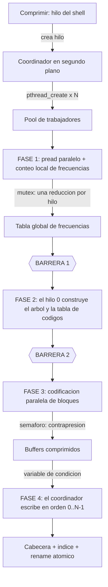

# Compresor Huffman Concurrente integrado al Shell

Módulo de compresión y descompresión **Huffman paralelo** con un pool de hilos POSIX,
integrado como tarea en segundo plano dentro de `sys_shell`.

El algoritmo está implementado desde cero: conteo de frecuencias, construcción del árbol,
tabla de códigos, empaquetado de bits y decodificación. **No se invoca ningún programa
externo de compresión.** (El comando `Zip`, de la categoría `datos`, sí delega en el
binario `zip` del sistema, pero es un ejercicio distinto: sirve para demostrar
`fork(2)` + `execvp(3)` y no forma parte de este módulo.)

---

## 1. Uso

| Comando | Qué hace |
| :--- | :--- |
| `Comprimir <archivo> [num_hilos]` | Comprime en segundo plano y genera `<archivo>.huff` |
| `Descomprimir <archivo.huff> [num_hilos]` | Restaura el archivo original, también en paralelo |
| `Tareas` | Muestra el progreso y el resultado de las tareas de la sesión |

`num_hilos` es opcional: por omisión se usan los núcleos disponibles (acotado a 2–16).
Poder fijarlo permite comparar tiempos con 1, 2, 4 u 8 hilos sobre el mismo archivo.

```
sys-shell> Comprimir grande.txt 8
Tarea 1 lanzada en segundo plano (grande.txt -> grande.txt.huff, 8 hilos).
El prompt sigue disponible; el avance se ira mostrando solo. Usa 'Tareas' para consultarlo.

sys-shell> [tarea 1] comprimiendo [#################---]  87% (codificando)
sys-shell> [tarea 1] listo grande.txt -> grande.txt.huff | 18000000 -> 9729700 bytes (ahorro 45.9%) | 0.28 s | 8 hilos
```

El prompt permanece disponible mientras la tarea avanza, y los avisos aparecen **por
encima** de la línea que se está escribiendo, sin borrar lo ya tecleado.

---

## 2. Arquitectura: cuatro fases



El archivo se divide en bloques de 64 KiB, que son la unidad de paralelismo.

**Fase 1 — Conteo.** Cada trabajador toma bloques y los lee con `pread(2)`, que recibe el
desplazamiento como argumento y por tanto **no comparte el cursor** del descriptor: varios
hilos leen el mismo archivo en paralelo sin pisarse. Las frecuencias se acumulan en una
tabla local en la pila del hilo (**reducción local**) y solo al final se suman a la tabla
global tomando el mutex **una única vez por hilo**, en lugar de miles de veces.

**Fase 2 — Árbol global.** No se puede codificar nada hasta que la tabla de frecuencias
esté completa, así que una **barrera** detiene a todos los hilos. Un solo hilo construye
el árbol con un min-heap y deriva la tabla de códigos; una segunda barrera garantiza que
el resultado sea visible para todos antes de continuar.

**Fase 3 — Codificación.** Con el árbol ya fijo, cada bloque es independiente. Cada
trabajador hace dos pasadas sobre su bloque: la primera suma las longitudes de los códigos
para reservar el buffer exacto, la segunda escribe los bits. Los códigos tienen longitud
variable, así que los bloques **casi nunca terminan en frontera de byte**: por eso el
índice guarda el número exacto de bits válidos de cada bloque.

**Fase 4 — Ensamblado en orden.** Los bloques se terminan en cualquier orden, pero el
archivo debe quedar secuencial. El coordinador recorre los bloques del 0 al N-1 y espera en
una **variable de condición** a que el bloque concreto que le toca esté listo.

---

## 3. Mecanismos de sincronización

| Mecanismo | Dónde | Qué protege y por qué se eligió |
| :--- | :--- | :--- |
| `pthread_mutex_t freq_mutex` | `huffman.c`, fase 1 | La reducción de las tablas locales sobre la global. Una sección crítica por hilo, no una por bloque. |
| `pthread_mutex_t work_mutex` | `take_next_chunk()` | El contador del siguiente bloque libre. Permite **reparto dinámico**: ningún hilo queda ocioso si un bloque resulta más costoso que otro. |
| `pthread_barrier_t barrier` | Entre fases 1→2→3 | Separa las fases. El pool **persiste** entre ellas en vez de crear y destruir hilos dos veces. |
| `pthread_cond_t out_cond` | Fase 4 | El coordinador duerme hasta que el bloque exacto que espera esté listo. `pthread_cond_wait` libera el mutex y bloquea el hilo: **cero espera activa**. |
| `sem_t slots` | Fase 3 | **Contrapresión**: limita cuántos buffers comprimidos existen a la vez (2 por hilo). Sin él, un escritor lento haría crecer la memoria sin control con archivos grandes. |
| `pthread_mutex_t g_term_mutex` | `main.c` | La terminal y la línea que el usuario está editando, compartidas entre el bucle del prompt y los hilos que notifican progreso. |
| Bloqueos lector/escritor por archivo | `cat_huffman.c` | Impiden que `Add`/`Delete` modifiquen un archivo que una tarea está procesando. `Print` pide lectura y sí puede coexistir con una compresión. |
| `pthread_cond_t g_task_cond` | `huff_wait_all()` | El shell espera a que las tareas terminen antes de cerrarse, para no matar hilos a medio escribir. |

### Por qué no puede haber interbloqueo

1. **Sin candados anidados en el motor.** El flag de error y la cola de salida comparten
   deliberadamente un único mutex (`out_mutex`), porque el coordinador necesita esperar por
   «el bloque está listo **o** algo falló». Con un solo candado y una sola condición no
   existe ninguna secuencia de adquisición anidada, así que no se puede formar un ciclo de
   espera.
2. **El permiso del semáforo se pide *antes* de reservar el bloque.** Este orden es la
   parte sutil. Si un hilo reservara el bloque `k` y *después* esperara un permiso, y todos
   los permisos estuvieran ocupados por bloques mayores que `k` ya comprimidos pero no
   escritos, el coordinador esperaría el bloque `k` para siempre y nadie liberaría un
   permiso. Pidiendo el permiso primero, todo bloque reservado tiene memoria garantizada.
3. **Los bloqueos de archivo no esperan nunca.** Son de tipo *try*: si el archivo está
   ocupado, el comando informa y termina. Ningún hilo se duerme reteniendo un bloqueo.
4. **El avance del coordinador está garantizado.** Los bloques se entregan en orden
   creciente, así que el bloque que el coordinador espera fue tomado antes que cualquier
   bloque mayor: siempre hay un hilo trabajando en él.

Comprobado con **Helgrind**, que analiza específicamente el orden de adquisición de
candados: 0 errores.

### Por qué no hay espera activa

Ningún bucle consulta repetidamente una variable compartida. El coordinador usa
`pthread_cond_wait`, los trabajadores `sem_wait`, y el hilo que dibuja el progreso
`pthread_cond_timedwait` (que además se despierta al instante cuando la tarea termina, en
lugar de esperar a que venza el intervalo). No se usa `sleep()` en ninguna parte.

---

## 4. Integración con el shell

**No bloquea la interfaz.** El comando crea el hilo coordinador y retorna de inmediato, así
que el prompt vuelve al instante. El coordinador es `detached` porque nadie hace `join` de
él; su finalización se sigue con un contador y una variable de condición, que es lo que
consulta `huff_wait_all()` cuando el shell va a cerrarse. Los trabajadores y el hilo de
progreso sí se cierran con `pthread_join`.

**Progreso en tiempo real.** Un hilo monitor consulta el avance cada 200 ms y publica una
barra cuando hay un cambio apreciable (≥5 %) o un cambio de fase, para no inundar la
terminal. El mensaje se inserta *encima* del prompt: se borra la línea, se escribe el
aviso y se repinta el prompt con el texto que el usuario llevaba tecleado.

**Condiciones de carrera con la edición.** El estado compartido con los hilos es la
terminal, la línea en edición y el registro de tareas; los tres están bajo mutex. Además,
los bloqueos por archivo evitan el escenario del enunciado: editar un archivo mientras se
comprime produciría un `.huff` que no corresponde a ningún contenido real.

```
sys-shell> Comprimir grande.txt 8
Tarea 1 lanzada en segundo plano (grande.txt -> grande.txt.huff, 8 hilos).

sys-shell> Add grande.txt "texto intruso"
'grande.txt' esta en uso por una tarea en segundo plano.
Escribe 'Tareas' para ver su progreso e intentalo cuando termine.
```

**Resultado atómico.** Se escribe en `<salida>.part` y solo al final se hace `rename(2)`.
Si el proceso muere a mitad del trabajo, el usuario nunca ve un `.huff` inválido.

---

## 5. Formato del archivo `.huff`

```
[ Cabecera: 2072 bytes ]
   magic[4] = "HUFF" | version u16 | flags u16
   chunk_size u32 | nchunks u32 | orig_size u64
   freq[256] u64          <- tabla de frecuencias global
[ Índice: nchunks x 24 bytes ]
   offset u64 | nbits u64 | raw_len u32 | pad u32
[ Datos: bloques comprimidos en orden ]
```

Dos decisiones del formato hacen posible todo lo demás:

- **Se guarda la tabla de frecuencias, no la de códigos.** El descompresor reconstruye un
  árbol *idéntico* porque la construcción es determinista: el min-heap desempata
  frecuencias iguales por orden de creación, y las hojas se insertan en orden de símbolo.
- **Se guarda un índice de bloques.** Es lo que permite que la **descompresión también sea
  paralela**: cada hilo decodifica un bloque y lo escribe con `pwrite(2)` en su posición
  exacta (`id * chunk_size`). Como cada hilo escribe en un rango de bytes ajeno a los
  demás, no hace falta ninguna cola ordenada.

El índice se **valida antes de decodificar** (desplazamientos dentro del archivo, `raw_len`
no mayor que el bloque, suma igual al tamaño original), para que un archivo corrupto o
manipulado no pueda hacer que los hilos lean fuera de los límites del buffer.

### Casos límite cubiertos

| Caso | Tratamiento |
| :--- | :--- |
| Archivo vacío | `nchunks = 0`, sin árbol; se restaura un archivo vacío |
| Un solo byte | Un bloque de 1 byte |
| Un único símbolo distinto (`"xxxx..."`) | Sin nodo interno el código tendría longitud 0 y sería imposible de escribir; se crea una raíz artificial para darle un código de 1 bit |
| Los 256 símbolos presentes | Árbol completo de 256 hojas |
| Datos incompresibles (aleatorios) | El resultado crece ligeramente, que es el comportamiento correcto de Huffman |

---

## 6. Verificación

Ejecutable con `./pruebas_huffman.sh`.

**Integridad** — 6 archivos x 3 configuraciones de hilos (1, 4, 8), comparando `md5sum` del
original con el restaurado:

| Archivo | Tamaño | Comprimido | md5 |
| :--- | ---: | ---: | :--- |
| vacío | 0 | 2 072 | idéntico |
| un byte | 1 | 2 097 | idéntico |
| un símbolo repetido | 100 000 | 14 620 | idéntico |
| texto repetitivo | 3 000 000 | 1 540 702 | idéntico |
| aleatorio (incompresible) | 2 000 000 | 2 002 816 | idéntico |
| los 256 símbolos | 1 048 576 | 1 051 032 | idéntico |

Los 2 072 bytes de un archivo vacío son la cabecera: la tabla de frecuencias ocupa un
tamaño fijo. Para archivos pequeños el `.huff` puede ser mayor que el original, que es el
compromiso normal de guardar el diccionario dentro del archivo.

**Herramientas de análisis dinámico:**

| Herramienta | Qué detecta | Resultado |
| :--- | :--- | :--- |
| ThreadSanitizer (`-fsanitize=thread`) | Condiciones de carrera | **0 avisos** (motor y shell completo) |
| Helgrind | Orden de candados, interbloqueos | **0 errores** |
| Valgrind Memcheck | Fugas de memoria, accesos inválidos | **0 fugas, 0 errores** (116 allocs / 116 frees) |
| GCC `-Wall -Wextra` | Avisos del compilador | **0 avisos** |

> ThreadSanitizer resultó decisivo: detectó una carrera real en la primera versión de la
> integración, donde el bucle del prompt mutaba la línea en edición fuera del mutex
> mientras un hilo de notificación la leía para repintarla. La corrección fue agrupar la
> mutación y el repintado en una sola sección crítica.

**Escalabilidad** (archivo de 24 MB, máquina de 4 núcleos). Los tiempos absolutos varían
según la máquina; lo relevante es la proporción:

| Hilos | Tiempo | Aceleración |
| ---: | ---: | ---: |
| 1 | 0,55 s | 1,00x |
| 2 | 0,28 s | 1,96x |
| 4 | 0,16 s | 3,44x |
| 8 | 0,17 s | 3,24x |

La aceleración es casi lineal hasta 4 hilos y se detiene ahí porque la máquina de prueba
tiene 4 núcleos: con 8 hilos no hay más CPU que repartir. Es la evidencia de que el trabajo
se está paralelizando de verdad y no solo repartiendo sobre un único núcleo.

---

## 7. Limitaciones conocidas

- **El archivo se carga completo en memoria.** Para un editor de texto es razonable, pero un
  archivo de varios GB fallaría con un error claro en lugar de procesarse por ventanas.
- **El formato asume el mismo orden de bytes (endianness).** Un `.huff` creado en una
  máquina big-endian no se descomprime en una little-endian. Los campos se escriben uno por
  uno para no depender del *padding* del compilador, pero no se normaliza el endianness.
- **Longitud máxima de código: 64 bits**, por el tipo que almacena el código. Alcanzar ese
  límite requeriría frecuencias de tipo Fibonacci sobre un archivo de decenas de terabytes;
  si ocurriera, el trabajo termina con un error explícito en lugar de corromper la salida.
- **Las tareas no se pueden cancelar** una vez lanzadas. `exit` espera a que terminen.
